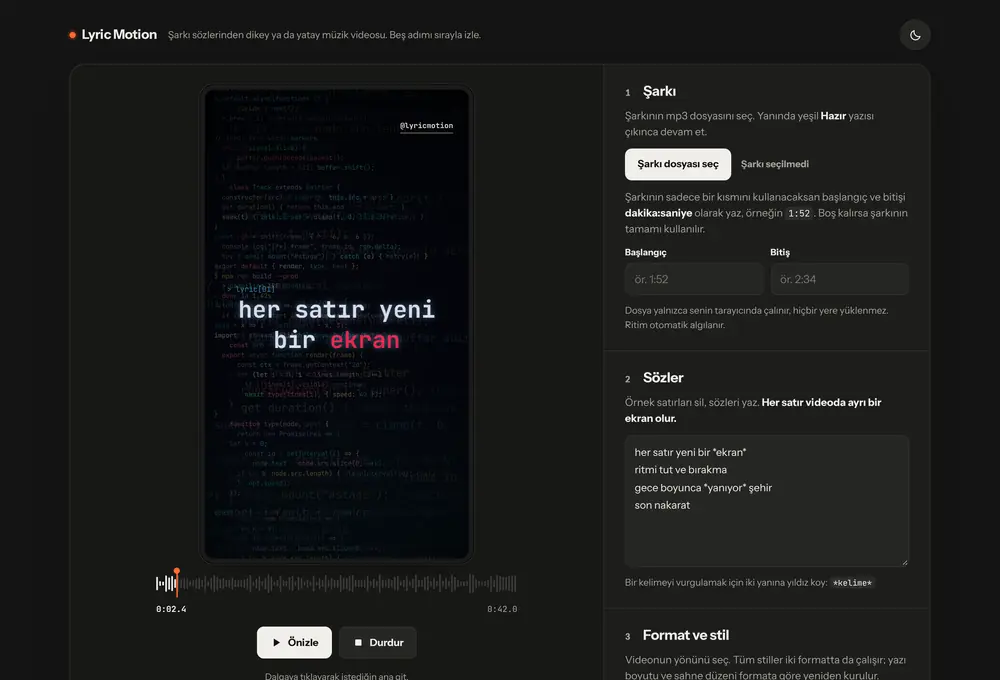
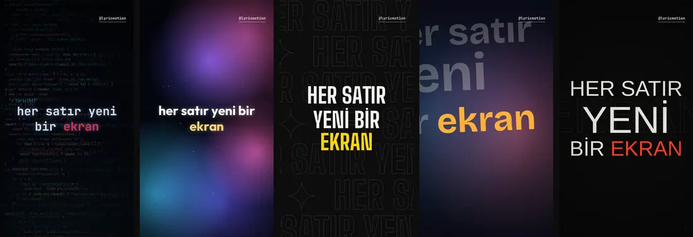
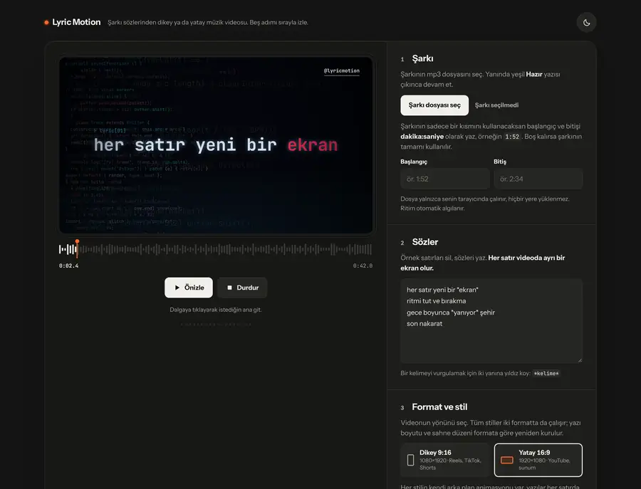

# Lyric Motion

A browser-based lyric video studio. Load a song, paste the lyrics, tap along to time each line, pick a style, and export a finished music video as an MP4 in vertical **9:16** (Reels, TikTok, Shorts) or horizontal **16:9** (YouTube) format.

The interface is in Turkish. Everything runs locally in the browser. There is no backend and no third-party JavaScript: the song never leaves the user's device.





## How to use

1. **Song:** choose an mp3 (or m4a / wav). The tempo is detected automatically. Optionally set a start and end time to use only part of the song.
2. **Lyrics:** write one line per screen. Wrap a word in asterisks (`*word*`) to highlight it.
3. **Format and style:** pick vertical 9:16 or horizontal 16:9, then one of the seven styles.
4. **Timing:** press *Dokunarak zamanla* (tap to time). The song plays and you tap the screen (or press Space) the moment each line starts. *Otomatik yerleştir* (auto) places the lines for you in one click.
5. **Export:** preview the video, then press *Videoyu oluştur ve indir* (create and download) to get an MP4 with the song included.



## Features

- **Tap-to-time:** the song plays in a full-screen overlay and the user taps when each line starts (with undo and keyboard support). An automatic mode spreads lines across the clip by syllable count, snapped to the beat.
- **Beat detection:** tempo and beat phase are estimated from the audio with an onset envelope, autocorrelation and a fine comb search.
- **Audio-reactive visuals:** per-frame bass / mid / high levels and transients drive zoom, glow, particles and camera shake.
- **7 animated styles:** Terminal, Lens, Aurora, Kinetic, Film, Punch and Flow, each with its own background and text animations. Punch and Flow animate word by word, with word timings derived from syllables and the beat grid.
- **Two formats:** every style re-lays out its typography and scene for 1080×1920 and 1920×1080.
- **Offline MP4 export:** frames are rendered one by one and encoded with the WebCodecs API (H.264 + AAC), then written to an `.mp4` by a small hand-written MP4 muxer. If WebCodecs is missing, it falls back to real-time `MediaRecorder` capture.
- **Turkish-aware typography:** grapheme segmentation and real glyph metrics keep letters like Ğ, İ, Ş from clipping or colliding.
- Clip trimming, an optional handle watermark, a light/dark UI and autosave to `localStorage`.

## Tech

Plain HTML, CSS and JavaScript, using Canvas 2D, the Web Audio API, WebCodecs and MediaRecorder. No frameworks, no dependencies.

## About this repository

This is a showcase repository. The full source code is kept in a private repository.

```
index.html          the app (runs the compiled build)
assets/             compiled, minified build of the app (+ UI stylesheet)
samples/            readable excerpts of the source (UI styles, waveform + theme toggle)
docs/               screenshots
```

The source is available for review on request (for example, for job applications).

## License

Copyright © 2026 Seçkin Yılmaz. All rights reserved. See [LICENSE](LICENSE).
